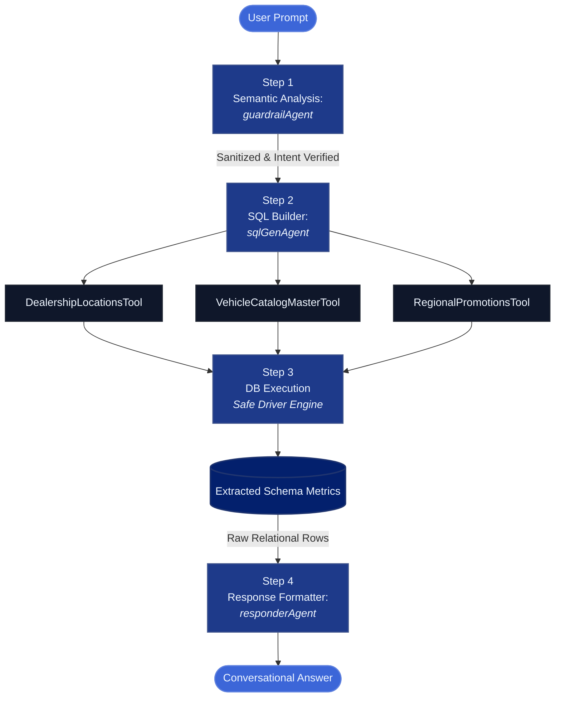

# Autonomous Enterprise Dealership Intelligence System

[](https://mastra.ai/)
[](https://www.microsoft.com/sql-server)
[](https://developer.mozilla.org/en-US/docs/Web/JavaScript)

A deterministic, multi-agent AI system built on the **Mastra framework** designed to process natural language queries across automotive dealership datasets. The architecture decouples query comprehension, domain-specific metric formulation, schema-aware SQL generation, and contextual response formatting across specialized agents and tools.

---

> [!NOTE]
> ### TL;DR
> * **What it is:** A Node.js backend workflow answering car dealership questions using natural language.
> * **How it works:** Translates questions into deterministic SQL queries against Microsoft SQL Server.
> * **Architecture:** 4-step sequential workflow coordinating 3 agents and 3 tools.
> * **Tech Stack:** Mastra, Node.js, Microsoft SQL Server, OpenRouter LLMs.           

---

## Architecture Overview

The system executes a strictly typed, 4-stage pipeline that guarantees SQL syntax validity, bounds query parameters to authorized schemas, and filters untrusted or destructive input:



---

## Pipeline Workflow Details

### 1. `step1_semanticAnalysisStep` (Guardrail Phase)
* **Agent**: `guardrailAgent`
* **Objective**: Analyzes raw natural language inputs before touching compute-intensive stages.
* **Mechanism**: Verifies semantic relevance to automotive inventory, dealership branches, or financing campaigns. Intercepts and denies prompt-injection attempts, out-of-scope domain requests, or malicious operations.

### 2. `step2_sqlBuilderStep` (Deterministic Metric & Query Formulation)
* **Agent**: `sqlGenAgent`
* **Objective**: Translates validated user intent into executable SQL Server queries.
* **Architecture**: Rather than delegating freeform text-to-SQL generation directly to an LLM, the agent delegates specific query parameters to dedicated schema tools:
  * `DealershipLocationsTool`: Extracts geolocation filters, service capability criteria, and branch names.
  * `VehicleCatalogMasterTool`: Resolves vehicle specs, drivetrain constraints, pricing boundaries, and fuel economy ratings.
  * `RegionalPromotionsTool`: Filters active campaign dates, targeted discount structures, and budget allocations.
* **Dynamic Generation**: Intermediate metric objects are combined to dynamically generate deterministic, syntactically verified SQL commands.

### 3. `step3_dbExecutionStep` (Execution Phase)
* **Objective**: Safe execution of generated queries against Microsoft SQL Server.
* **Mechanism**: Executes parameterized queries, handles database error recovery, and encapsulates raw query result sets into structured JSON payload buffers.

### 4. `step4_responseFormatterStep` (Synthesis Phase)
* **Agent**: `responderAgent`
* **Objective**: Transforms structured tabular datasets into user-friendly business summaries.
* **Mechanism**: Formats currency, comparative specifications, inventory availability, and regional dealership details into concise conversational responses.

---

## Database Schema Reference

The system interfaces with three core relational tables hosted on Microsoft SQL Server:

### 1. `dbo.DealershipLocations`
Stores branch footprints, physical addresses, and operational facility metrics.
* `LocationID`: Unique dealership identifier.
* `BranchName`: Dealership branch naming.
* `StreetAddress`, `City`, `StateCode`, `PostalCode`: Geospatial address attributes.
* `Phone`, `OperatingLicenseNumber`: Branch metadata.
* `ShowroomSqFt`, `ServiceBaysCount`: Capacity indicators.
* `OpeningYear`: Branch historical tenure.

### 2. `dbo.VehicleCatalogMaster`
Tracks inventory specifications, engineering metrics, and standard pricing.
* `CatalogID`: Unique vehicle listing ID.
* `Make`, `Model`, `ModelYear`: Vehicle identification.
* `VehicleBodyType`, `Drivetrain`, `FuelType`: Powertrain and chassis layout.
* `EngineDisplacementLiters`: Engine displacement size.
* `StandardMSRP`: Base manufacturer retail price.
* `NHTSASafetyRating`: Standardized collision test ratings (1–5).
* `EPACombinedMPG`: Fuel efficiency rating.

### 3. `dbo.RegionalPromotions`
Maintains promotional marketing campaigns, active financial incentives, and eligibility.
* `CampaignID`: Unique promotional entry ID.
* `CampaignName`: Marketing title.
* `TargetAudienceTier`, `PromotionalChannel`: Segmentation rules.
* `DiscountType`, `DiscountValue`: Incentive structure.
* `MinPurchaseRequirement`, `AllocatedBudget`: Financial constraints.
* `CampaignStartDate`, `CampaignEndDate`: Validity intervals.

---

## Quickstart

```bash
# 1. Clone repository
git clone [https://github.com/Viji-RaviChandran/mastra-car-dealership-workflow.git](https://github.com/Viji-RaviChandran/mastra-car-dealership-workflow.git)
cd mastra-car-dealership-workflow

# 2. Install dependencies
npm install

# 3. Add your environment credentials in .env (DB connection + LLM API key)

# 4. Start the Mastra playground
npm run dev
```

---

Core workflow logic, tools, and agents reside inside src/mastra/